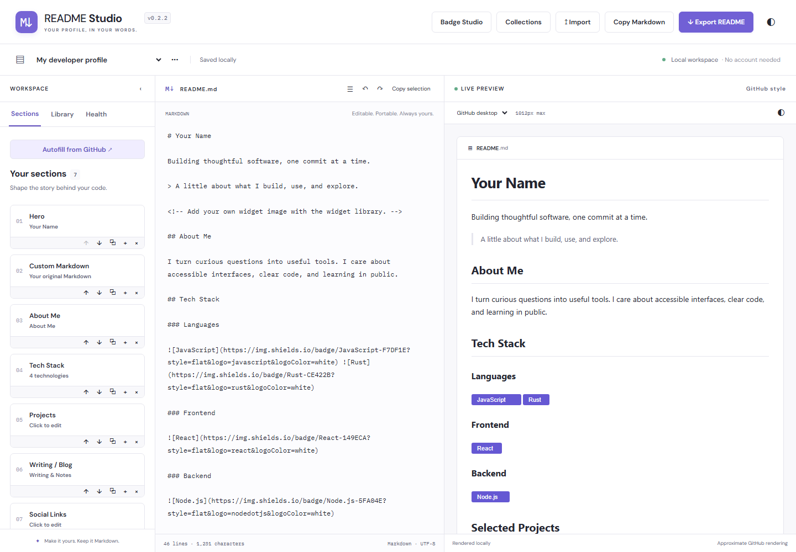

# README Studio

A local-first workspace for creating GitHub profile and repository READMEs. Build visually, edit Markdown directly, and export an ordinary `README.md` with no Studio runtime dependency.

**Version 1.9.0.** Stack Intelligence can include nested manifests in monorepos with a separate, session-only consent, mapping each Manifest to the repository root, a Workspace member or a Nested project. Discovery reads one tree at the head commit, stays within depth, read and request limits, and rejects unsafe paths, symlinks and submodules with notices. [Stack Intelligence](docs/stack-intelligence.md#nested-discovery-monorepos) · [Stack-to-README](docs/stack-to-readme.md) · [GitHub publishing](docs/github-publishing.md)



## Start locally

Requires Node.js 22.12 or newer.

```sh
npm ci
npm run dev
```

Guided start asks whether you want to write a profile README, write a repository README or audit your repository READMEs, and says where your work is kept; templates, Markdown import, Studio projects and blank drafts remain one click away. After you start, [Next steps](docs/next-steps.md) suggests what usually comes next without changing anything. Use the Create, Design, Review, GitHub and Save groups; `Ctrl/Cmd+K` searches tools and content. [Getting started](docs/getting-started.md) · [Task tutorials](docs/tutorials.md) · [All documentation](docs/index.md)

## What you can do

- Compose sections, badges and collections, project showcases, components and reusable snippets.
- Coordinate themes, generate local light/dark SVG banners, and configure attributed external widget embeds.
- Import public GitHub data, review refreshes, analyze compatibility and apply explicit, undoable refactors.
- Audit selected public repositories with advisory expectations for 14 project types, then choose the next README from the attention queue.
- Analyze declared dependencies in repository manifests with explicit consent, including bounded monorepo discovery that maps Workspace members and Nested projects ([Stack Intelligence](docs/stack-intelligence.md)). Every declaration shows where and when it was observed and a named confidence basis, with uncertain and Stale results labelled ([Provenance, confidence and staleness](docs/stack-intelligence.md#provenance-confidence-and-staleness)).
- Record read-only evidence snapshots of a repository's branch head, README, manifests and linked files, then check what changed since a pinned Baseline.
- Check for stale scripts, missing files, broken links and anchors, and outdated config keys without running repository code or changing your Markdown.
- Save portable `.readme-studio.json` projects or export Markdown, packs and full workspace backups.
- Optionally publish reviewed README, asset and workflow changes through a separately configured GitHub App service. Publishing starts read-only and unlocks only after a [Preflight](docs/github-publishing.md#preflight) of app, permission and branch access passes.

Manual Markdown remains available. Raw edits detach structured ownership when synchronization is unsafe. Themes guide generated content; they cannot style GitHub itself. The app light/dark switch updates preview too, with a separate preview override.

## Your data

Drafts autosave to this browser. **Download a backup before clearing browser storage.** Storage failures remain visible, and damaged data opens a temporary workspace with recovery downloads rather than silently replacing originals. Portable projects retain source and supported editing metadata; Markdown exports retain source only. [Editing and recovery](docs/editing.md) · [Project files](docs/studio-projects.md)

Core editing, analysis and export work offline after the production app has successfully cached. Public GitHub fetches, publishing and remote images need a connection. Remote previews contact their providers directly. [Offline behavior](docs/offline.md) · [Privacy](docs/privacy.md) · [Security](docs/security.md)

## Build and verify

```sh
npm test
npx playwright install chromium firefox webkit
npm run test:browser:all
npm run build
npm run test:static
npm run report:bundle
```

Serve `dist/` with a static HTTP server, GitHub Pages subpath or Netlify; no router fallback or frontend environment variables are required. Opening `index.html` through `file://` is not supported. Optional publishing needs the [HTTPS server setup](docs/github-publishing.md); a static deployment alone does not enable writes.

[Contributor guide](CONTRIBUTING.md) · [Architecture](docs/architecture.md) · [Synthetic examples](examples/README.md) · [Known limitations](docs/known-limitations.md) · [Changelog](CHANGELOG.md)

MIT licensed. See [LICENSE](LICENSE) and [third-party notices](THIRD_PARTY_NOTICES.md). Preview approximates GitHub; automated browser tests are not accessibility certification or proof of a live publishing deployment.
